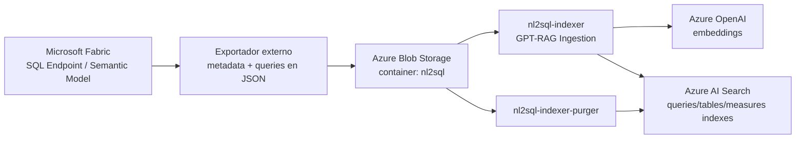
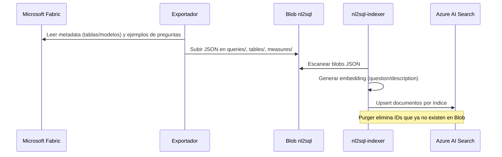
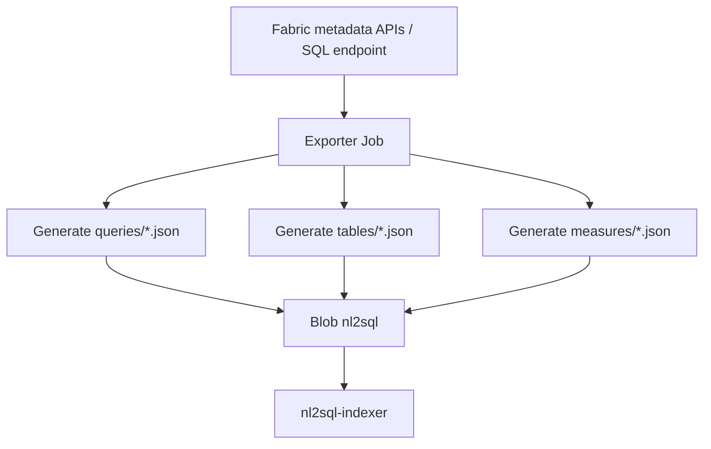
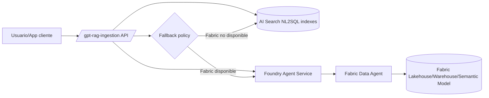

# Guía Exhaustiva: Uso de Microsoft Fabric con GPT-RAG Ingestion

## Tabla de contenidos
- [1. Respuesta corta: ¿este repo soporta Fabric?](#1-respuesta-corta-este-repo-soporta-fabric)
- [2. Qué soporta exactamente (y qué no)](#2-qué-soporta-exactamente-y-qué-no)
- [3. Arquitectura del flujo con Fabric](#3-arquitectura-del-flujo-con-fabric)
- [4. Prerrequisitos](#4-prerrequisitos)
- [5. Estructura de archivos requerida en Blob](#5-estructura-de-archivos-requerida-en-blob)
- [6. Paso a paso completo (implementable)](#6-paso-a-paso-completo-implementable)
- [7. Configuración recomendada (App Config / variables)](#7-configuración-recomendada-app-config--variables)
- [8. Ejemplo end-to-end con datos de samples/fabric](#8-ejemplo-end-to-end-con-datos-de-samplesfabric)
- [9. Automatización opcional: exportar metadata desde Fabric hacia JSON](#9-automatización-opcional-exportar-metadata-desde-fabric-hacia-json)
- [10. Validación y troubleshooting](#10-validación-y-troubleshooting)
- [11. Buenas prácticas operativas](#11-buenas-prácticas-operativas)
- [12. Checklist final](#12-checklist-final)
- [13. Extensión Híbrida: Foundry + Fabric Data Agent (tiempo real)](#13-extensión-híbrida-foundry--fabric-data-agent-tiempo-real)

---

## 1. Respuesta corta: ¿este repo soporta Fabric?

Sí, pero **no como conector nativo directo a Fabric**.

Este repositorio soporta Fabric mediante el pipeline de **NL2SQL ingestion**:
- Ingieres archivos JSON en un contenedor Blob (`nl2sql`), con carpetas `queries/`, `tables/`, `measures/`.
- Esos JSON pueden representar metadata y preguntas de Microsoft Fabric (por ejemplo `sql_endpoint` y `semantic_model`).
- El job `nl2sql-indexer` procesa esos JSON, genera embeddings y los indexa en Azure AI Search.

En resumen: **Fabric -> (exportas metadata a JSON) -> Blob -> nl2sql-indexer -> AI Search**.

---

## 2. Qué soporta exactamente (y qué no)

### 2.1 Soportado en este repo
1. Indexación de JSON NL2SQL con contenido de Fabric.
2. Separación en 3 índices (queries, tables, measures).
3. Purga de documentos huérfanos (`nl2sql-indexer-purger`).
4. Ejecución por cron y/o ejecución manual del job.

### 2.2 No soportado nativamente
1. Conector directo a Fabric para descubrir tablas/modelos automáticamente.
2. Ejecución de consultas Fabric en tiempo real desde este servicio.
3. Sincronización automática “pull” contra Fabric sin capa externa.

---

## 3. Arquitectura del flujo con Fabric

### 3.1 Diagrama de componentes



### 3.2 Flujo secuencial



---

## 4. Prerrequisitos

### 4.1 Azure
1. Storage Account con contenedor `nl2sql`.
2. Azure AI Search con 3 índices:
   - `SEARCH_QUERIES_INDEX_NAME`
   - `SEARCH_TABLES_INDEX_NAME`
   - `SEARCH_MEASURES_INDEX_NAME`
3. Azure OpenAI/Foundry con deployment de embeddings.
4. App Configuration (o variables de entorno equivalentes).
5. Permisos RBAC de la identidad del servicio:
   - Storage Blob Data Contributor
   - Search Index Data Contributor
   - Cognitive Services User
   - App Configuration Data Reader

### 4.2 Microsoft Fabric
1. Workspace y artefactos de datos (SQL endpoint / semantic model).
2. Principal (service principal o identidad) con permisos de lectura para obtener metadata.

### 4.3 Local/operación
1. Azure CLI autenticado (`az login`).
2. Python 3.12 si ejecutarás jobs localmente.

---

## 5. Estructura de archivos requerida en Blob

En el contenedor `nl2sql` debes mantener esta estructura:

```text
nl2sql/
  queries/
    *.json
  tables/
    *.json
  measures/
    *.json
```

### 5.1 Esquema esperado por tipo

#### queries/*.json
```json
{
  "datasource": "wwi-sales-aggregated-data",
  "question": "Who are the top 5 employees with the highest total sales including tax?",
  "query": "EVALUATE TOPN(...)",
  "reasoning": "..."
}
```

#### tables/*.json
```json
{
  "table": "fact_sale",
  "datasource": "wwi-sales-star-schema",
  "description": "Sales fact table containing...",
  "columns": [
    {"name": "SaleKey", "description": "Primary key"}
  ]
}
```

#### measures/*.json
Si usas medidas, sigue el mismo patrón semántico (nombre, descripción, datasource, fórmula o definición).

#### datasources.json (catálogo de origen)
Se usa como referencia de dominio y mapeo conceptual. Ejemplo real del repo:
```json
[
  {
    "id": "wwi-sales-star-schema",
    "type": "sql_endpoint",
    "server": "<endpoint>.datawarehouse.fabric.microsoft.com",
    "database": "<lakehouse_or_warehouse>"
  },
  {
    "id": "wwi-sales-aggregated-data",
    "type": "semantic_model",
    "dataset": "<dataset_name>"
  }
]
```

---

## 6. Paso a paso completo (implementable)

## Paso 1: Crear el contenedor `nl2sql`

```bash
az storage container create \
  --name nl2sql \
  --account-name <STORAGE_ACCOUNT_NAME> \
  --auth-mode login
```

## Paso 2: Preparar artefactos JSON de Fabric

Puedes iniciar con los samples del repo:
- `samples/fabric/datasources.json`
- `samples/fabric/queries/*.json`
- `samples/fabric/tables/*.json`

## Paso 3: Subir archivos al contenedor

```bash
# Desde la raíz del repo
az storage blob upload-batch \
  --account-name <STORAGE_ACCOUNT_NAME> \
  --destination nl2sql \
  --source samples/fabric \
  --auth-mode login
```

Esto publicará `queries/` y `tables/` dentro de `nl2sql`.

## Paso 4: Configurar variables clave del servicio

Define estas claves en App Configuration (o variables de entorno equivalentes):

```text
STORAGE_ACCOUNT_NAME=<tu_storage>
NL2SQL_STORAGE_CONTAINER=nl2sql
SEARCH_QUERIES_INDEX_NAME=<index_queries>
SEARCH_TABLES_INDEX_NAME=<index_tables>
SEARCH_MEASURES_INDEX_NAME=<index_measures>
INDEXER_MAX_CONCURRENCY=4
JOBS_LOG_CONTAINER=jobs
CRON_RUN_NL2SQL_INDEX=0 */4 * * *
CRON_RUN_NL2SQL_PURGE=15 */4 * * *
```

## Paso 5: Ejecutar indexación

### Opción A: por scheduler (recomendada en runtime)
Si el servicio está arriba, el scheduler ejecutará `nl2sql-indexer` según cron.

### Opción B: ejecución manual local

```bash
python -c "import asyncio; from jobs.nl2sql_indexer import NL2SQLIndexer; asyncio.run(NL2SQLIndexer().run())"
```

## Paso 6: Ejecutar purga de huérfanos

```bash
python -c "import asyncio; from jobs.nl2sql_purger import NL2SQLPurger; asyncio.run(NL2SQLPurger().run())"
```

## Paso 7: Validar resultados en AI Search

Comprueba conteos en cada índice (`queries`, `tables`, `measures`) usando Search Explorer o SDK.

---

## 7. Configuración recomendada (App Config / variables)

| Clave | Requerida | Propósito |
|---|---|---|
| `STORAGE_ACCOUNT_NAME` | Sí | Cuenta de Blob donde vive `nl2sql` |
| `NL2SQL_STORAGE_CONTAINER` | Sí | Contenedor de entrada (`nl2sql`) |
| `SEARCH_QUERIES_INDEX_NAME` | Sí | Índice para preguntas/queries |
| `SEARCH_TABLES_INDEX_NAME` | Sí | Índice para tablas |
| `SEARCH_MEASURES_INDEX_NAME` | Sí | Índice para medidas |
| `INDEXER_MAX_CONCURRENCY` | Recomendado | Paralelismo del indexador |
| `JOBS_LOG_CONTAINER` | Recomendado | Logs por ejecución |
| `CRON_RUN_NL2SQL_INDEX` | Recomendado | Frecuencia de indexación |
| `CRON_RUN_NL2SQL_PURGE` | Recomendado | Frecuencia de purga |
| `AI_FOUNDRY_ACCOUNT_ENDPOINT` | Sí | Endpoint de OpenAI/Foundry |
| `EMBEDDING_DEPLOYMENT_NAME` | Sí | Deployment de embeddings |

---

## 8. Ejemplo end-to-end con datos de samples/fabric

## 8.1 Cargar sample

```bash
az storage blob upload-batch \
  --account-name <STORAGE_ACCOUNT_NAME> \
  --destination nl2sql \
  --source samples/fabric \
  --auth-mode login
```

## 8.2 Ejecutar indexador

```bash
python -c "import asyncio; from jobs.nl2sql_indexer import NL2SQLIndexer; asyncio.run(NL2SQLIndexer().run())"
```

## 8.3 Qué deberías ver
1. Logs de inicio con conteo por carpeta (`queries`, `tables`, `measures`).
2. Embeddings generados desde:
   - `question` en `queries`
   - `description` en `tables/measures`
3. Resumen final en contenedor `jobs` con status `finished`.

---

## 9. Automatización opcional: exportar metadata desde Fabric hacia JSON

Si quieres “lectura desde Fabric” más cercana a tiempo real, implementa un exportador externo (job aparte) que:
1. Lea metadata de Fabric (tablas, columnas, medidas, ejemplos de consultas).
2. Genere JSON en formato NL2SQL.
3. Suba esos JSON al contenedor `nl2sql`.
4. Dispare `nl2sql-indexer`.

### 9.1 Diagrama de extensión



### 9.2 Contrato mínimo del exportador
- Garantizar nombres estables de archivos JSON para preservar IDs en AI Search.
- Mantener carpetas exactas `queries/`, `tables/`, `measures/`.
- Validar que cada JSON tenga `datasource` y `description`/`question`.

---

## 10. Validación y troubleshooting

### 10.1 Checklist de validación rápida
1. ¿Existen blobs en `nl2sql/queries|tables|measures`?
2. ¿Están seteadas las 3 claves de índices de Search?
3. ¿El deployment de embeddings responde?
4. ¿La identidad tiene RBAC en Blob y Search?

### 10.2 Fallas comunes

1. **No indexa nada**
- Causa frecuente: blobs fuera de carpetas esperadas o sin `.json`.
- Corrección: mover a `queries/`, `tables/`, `measures/`.

2. **Errores de embeddings**
- Causa frecuente: falta `EMBEDDING_DEPLOYMENT_NAME` o cuota agotada.
- Corrección: validar deployment y límites TPM/RPM.

3. **Purger elimina de más**
- Causa frecuente: cambios de nombre de archivo (ID cambia).
- Corrección: estrategia de naming estable.

4. **No corre por cron**
- Causa frecuente: `CRON_RUN_NL2SQL_INDEX`/`PURGE` no definidos.
- Corrección: definir cron en App Config.

---

## 11. Buenas prácticas operativas

1. Versiona JSON en Git antes de subir a Blob.
2. Usa naming estable para evitar churn de IDs.
3. Ejecuta index y purge en ventanas separadas (ej. +15 min).
4. Monitorea `jobs` container para auditoría de runs.
5. Mantén un pipeline CI que valide schema JSON antes de publicar.

---

## 12. Checklist final

- [ ] Confirmé que el flujo Fabric es indirecto vía NL2SQL JSON.
- [ ] Creé y poblé contenedor `nl2sql`.
- [ ] Configuré índices `queries/tables/measures`.
- [ ] Configuré variables de App Config para NL2SQL.
- [ ] Ejecuté `nl2sql-indexer` con éxito.
- [ ] Ejecuté `nl2sql-indexer-purger` con éxito.
- [ ] Validé documentos en AI Search.

---

## 13. Extensión Híbrida: Foundry + Fabric Data Agent (tiempo real)

Esta sección agrega el patrón de consultas dinámicas en tiempo real, complementando la indexación NL2SQL batch.

### 13.1 Arquitectura híbrida recomendada



### 13.2 ¿Qué aporta este modo?
1. Consultas frescas de negocio sobre Fabric (tiempo real).
2. Mantener recuperación semántica indexada como fallback robusto.
3. Separar casos: "knowledge retrieval" vs "live analytics".

### 13.3 Prerrequisitos adicionales (híbrido)
1. Fabric Data Agent creado y publicado.
2. Foundry Project en el mismo tenant que Fabric.
3. Conexión Microsoft Fabric en Foundry (`workspace_id`, `artifact_id`).
4. Identidad de usuario final disponible para passthrough (OBO) en escenarios protegidos.

### 13.4 Configuración adicional sugerida

```text
FOUNDRY_PROJECT_ENDPOINT=https://<foundry-resource>.ai.azure.com/api/projects/<project>
FOUNDRY_MODEL_DEPLOYMENT_NAME=gpt-4.1-mini
FABRIC_PROJECT_CONNECTION_ID=/subscriptions/.../projects/.../connections/<connectionName>
FABRIC_AGENT_NAME=fabric-data-agent-bridge
FABRIC_AGENT_INSTRUCTIONS=Use the Fabric tool for sales, customers and product analytics.
FABRIC_FORCE_TOOL_CHOICE=true
FABRIC_REQUIRE_USER_IDENTITY=true
```

### 13.5 Endpoint híbrido de ejemplo (implementado en el repo)
Se agregó:
- `POST /fabric-data-agent-query`

Request:
```json
{
  "question": "What are the top 5 products by revenue this month?"
}
```

Headers:
```text
X-API-KEY: <ingestion-api-key>
Authorization: Bearer <user_token>
```

### 13.6 Flujo operativo recomendado
1. Mantén `nl2sql-indexer` y `nl2sql-indexer-purger` para base semántica confiable.
2. Envía preguntas analíticas a `/fabric-data-agent-query`.
3. Si falla Fabric/Foundry, enruta a respuesta de búsqueda en índices NL2SQL.

### 13.7 Limitaciones conocidas
1. El tool de Fabric está en preview.
2. Algunos escenarios (por ejemplo publicación a Teams con MI administrada) pueden no soportar passthrough.
3. Debes alinear permisos de usuario en Fabric y fuentes subyacentes.

---

## Nota final de alcance

Este repositorio **sí** soporta escenarios con datos de Fabric, siempre que los representes en el formato NL2SQL esperado en Blob. Para conector directo a Fabric (descubrimiento automático), necesitas una capa adicional (exportador) aguas arriba.
